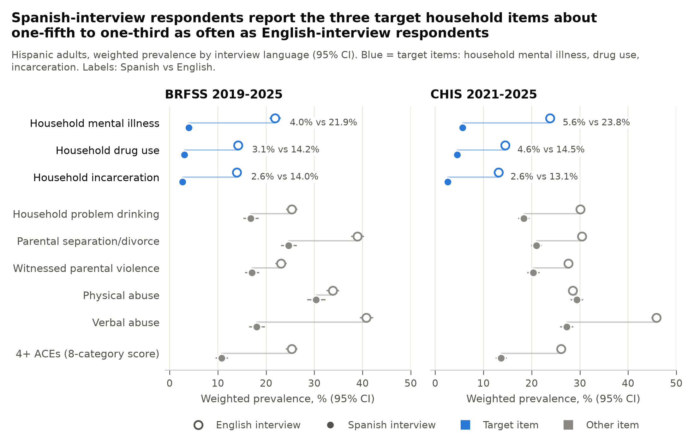
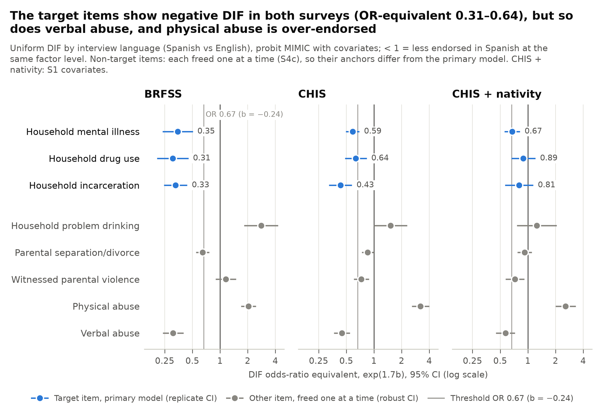
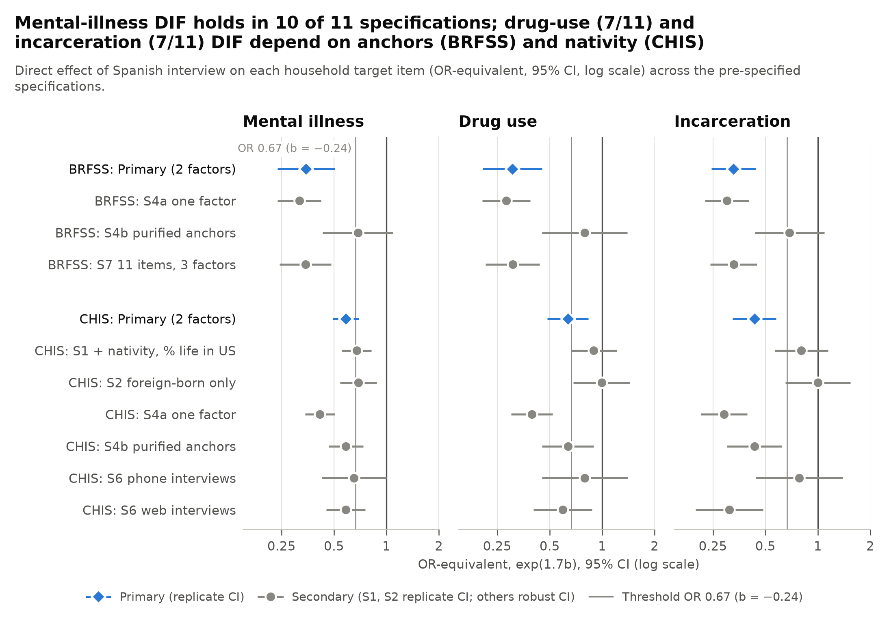
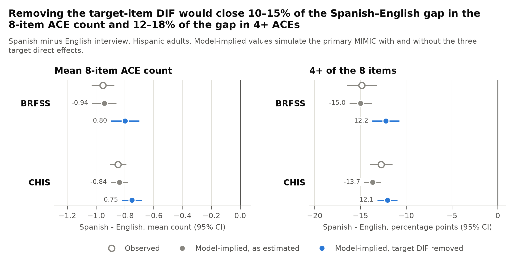

# Does interview language change how Hispanic adults report childhood household adversity? Differential item functioning of adverse childhood experience items by Spanish versus English interview in two US surveys

**Isabella Ciocca**1, **Matias Ortiz**2

1 Icahn School of Medicine at Mount Sinai, New York, NY. 2 Courant Institute of Mathematical Sciences, New York University, New York, NY. Correspondence: mo2273@nyu.edu

*Preprint, version 0.1, 2 November 2026. Not peer reviewed. Working draft circulated for comment; see Declarations for the repository and timestamp.*

**Key points**

**Question.** Do the Behavioral Risk Factor Surveillance System (BRFSS) adverse childhood experience (ACE) items function the same way when Hispanic adults are interviewed in Spanish rather than English?

**Findings.** In BRFSS 2019–2025 (n = 35,418) and the California Health Interview Survey (CHIS) 2021–2025 (n = 29,954), Spanish-interview respondents reported household mental illness, drug use and incarceration one-fifth to one-third as often as English-interview respondents. At the same level of the other household items, all three were still under-endorsed in both surveys. Only household mental illness remained under-endorsed after nativity adjustment, among foreign-born adults, in both phone and web interviews, and in an anchor-free analysis; an exploratory analysis of parent reports in the National Survey of Children's Health showed the same item-specific gap.

**Meaning.** The household mental-illness ACE item is the one item with consistent evidence of non-equivalence across interview languages. Whether this reflects how the condition is labelled and disclosed in Spanish or real differences in childhood households cannot be settled here, but on either reading the item is not directly comparable across interview languages. Item-level differences explain at most a fifth of the language gap in ACE scores.

**What this study adds, and what it does not claim**

- **Adds.** The first test of item-level measurement equivalence (differential item functioning, DIF) of ACE items by interview language, in any survey (literature searched through 2 November 2026; Supplement S8). The test is replicated in two surveys that ask the same English questions with independent Spanish translations and different modes, and in one survey it is adjusted for nativity.
- **Closest prior work.** Alhalel (2018) compared BRFSS item prevalence by questionnaire language without conditioning on the other items. Cooper and Nickodem (2021) tested Spanish–English invariance of a 59-item lifetime-adversity model in an all-immigrant sample. Ford et al. (2014) and Mei et al. (2022) tested BRFSS ACE invariance by sex, age and race/ethnicity, not language. Jensen et al. (2024) found threshold non-invariance across racial/ethnic groups in parent-reported child ACEs.
- **Does not claim.** That Spanish-interview respondents report fewer ACEs (already shown by Alhalel 2018 and Grest et al. 2021); that this is a confirmatory test (the hypothesis came from exploratory analyses of the same data, and the specification was locked afterwards); or anything about uniform under-reporting across all items, which no internal analysis can detect.

## Abstract

**Introduction.** Adverse childhood experience (ACE) prevalence is compared across population groups, but whether the items work the same way in Spanish-language interviews is unknown. This study tested whether Hispanic adults interviewed in Spanish endorse three household items, mental illness, drug use and incarceration, less often than English-interview respondents at the same level of household adversity, and whether any difference survives adjustment for nativity.

**Methods.** Secondary analysis of BRFSS 2019–2025 (10,945 Spanish- and 24,473 English-interview Hispanic adults) and CHIS 2021–2025 (5,536 and 24,418), two surveys with the same English ACE items and independent Spanish translations. Survey-weighted multiple-indicators multiple-causes (MIMIC) models estimated item-level DIF by interview language, with replicate-weight variance for the primary models. The hypothesis came from exploratory analyses; the model specification was locked before fitting and is reported with all pre-specified sensitivity analyses. Exploratory analyses of the National Survey of Children's Health (NSCH) 2022–2024 and of respondents' own mental-health reports are reported separately.

**Results.** Spanish-interview respondents reported household mental illness in 4.0% vs 21.9% (BRFSS) and 5.6% vs 23.8% (CHIS). At the same level of household dysfunction, all three items were endorsed less often in Spanish in both surveys (odds-ratio equivalents 0.31–0.35 in BRFSS and 0.43–0.64 in CHIS), meeting the pre-specified criterion. These estimates depend on which items are treated as invariant: with purified anchors the BRFSS effects were no longer significant (0.68–0.79). After nativity adjustment in CHIS, only the mental-illness DIF remained (0.67; 95% CI 0.55–0.82), including among foreign-born adults (0.69; 0.54–0.88); it was similar by phone and web and was the largest shift in anchor-free alignment in both surveys. Drug-use and incarceration DIF tracked nativity. Removing the three target effects would close at most 10–18% of the model-implied language gap in 8-item ACE counts. In NSCH parent reports, the household mental-illness item showed the same gap by household language (adjusted OR 0.32).

**Conclusions.** Among ACE items, household mental illness shows the most consistent evidence of non-equivalence by interview language. ACE comparisons involving Spanish-speaking respondents should treat this item with caution, and its Spanish wording should be tested directly.

## 1. Introduction

Adverse childhood experiences (ACEs), meaning abuse and household dysfunction before age 18, are among the most widely used exposures in population health (Felitti et al. 1998). The Behavioral Risk Factor Surveillance System (BRFSS) has made them a surveillance measure: in 2011–2020, 63.9% of US adults reported at least one ACE and 17.3% reported four or more (Swedo et al. 2023). These estimates are compared across population groups to target prevention (CDC 2019; Swedo et al. 2023).

Group comparisons assume each question works the same way in every group. For the BRFSS items this has been tested by gender and age (Ford et al. 2014), and by age, sex, race and ethnicity, income, sexual orientation and gender identity (Mei et al. 2022). Parent-reported child ACEs failed scalar invariance across racial and ethnic groups (Jensen et al. 2024), and a 2026 dissertation found the BRFSS items non-invariant across racial and ethnic groups, with differences concentrated in the household mental illness, incarceration and alcohol items (Umoga 2026). None of these studies examined the language of the interview.

Language matters because many Hispanic adults are interviewed in Spanish: about 40% of Hispanic BRFSS respondents in 2003–2005 (DuBard and Gizlice 2008) and 52% of Hispanic CHIS adults in 2009 (Kim et al. 2016). Interview language shifts answers to other survey questions. Spanish-language respondents rate their health worse partly because "regular" is not equivalent to "fair" (Viruell-Fuentes et al. 2011; Bzostek et al. 2007), and item-level language effects have been found for psychological distress (Kim et al. 2016), cognitive screening (Jones 2006) and political attitudes (Pérez 2011).

For ACEs, six of 11 BRFSS items differed in prevalence by questionnaire language among Hispanic respondents (Alhalel 2018), and immigrant families report fewer household adversities than US-born families (Caballero et al. 2017; Grest et al. 2021). These studies did not ask whether lower prevalence reflects less adversity or different reporting at the same level of adversity. The only Spanish–English invariance test involving ACE items embedded them in a broader adversity model in an all-immigrant sample (Cooper and Nickodem 2021).

Three household items may be especially sensitive to language: whether someone in the household was mentally ill, used drugs, or was incarcerated. Each asks the respondent to label a family member's condition, and each condition carries stigma that extends to the family (Corrigan et al. 2006; Luther 2016). Among Latinos, mental-illness stigma discourages disclosure (Interian et al. 2007; Vega et al. 2010), and families may describe distress as "nervios" rather than mental illness (Jenkins 1988). Embarrassing answers are under-reported in surveys (Tourangeau and Yan 2007), especially about criminal-justice involvement (Yan and Cantor 2019), and proxy reports of household mental illness are low even in English: parents report it far less often than their teenagers do (Ng et al. 2025).

We therefore tested whether Spanish-interview Hispanic adults are less likely than English-interview Hispanic adults to endorse these three items at the same latent level of household dysfunction (H1), using two surveys that ask the same English questions with independent Spanish translations, BRFSS 2019–2025 and CHIS 2021–2025. In CHIS we tested whether any difference persists after accounting for nativity (H1b). The grouping of the three items was suggested by exploratory analyses of the same data and then pre-specified; the item-level DIF question has not, to our knowledge, been asked of ACE items by interview language before.

## 2. Methods

### 2.1 Design and data sources

This is a cross-sectional secondary analysis of two population surveys that ask the same English-language ACE questions with different Spanish translations. The models reported in §3.3–3.6 followed an analysis plan frozen before they were fitted (§2.5).

**BRFSS** is a state-based telephone survey of noninstitutionalized US adults, run by state health departments with CDC (CDC 2024). States may add an optional ACE module. We used the 2019–2025 public-use files and the questionnaire-version files; states that fielded the module on only one questionnaire version have blank ACE fields in the main file, so main-file-only analyses would lose 12–36% of ACE respondents per year. Interviews are in English or Spanish and the language is recorded.

**CHIS** samples California adults; most complete it on the web and the rest by telephone (California Health Interview Survey 2024). CHIS asked the BRFSS ACE items in every year from 2021 to 2025, with its own Spanish translation. We used the 2021–2025 adult public-use files, which record interview language, nativity and percentage of life lived in the US.

### 2.2 Analytic samples

Both samples were restricted to Hispanic adults interviewed in English or Spanish.

- **BRFSS:** respondents in 41 states and the District of Columbia (11–28 per year) with valid answers to all 11 ACE items: 10,945 Spanish-interview and 24,473 English-interview. Territories were excluded because Puerto Rico's 2024 sample had no English-interview respondents.
- **CHIS:** 5,536 Spanish-interview and 24,418 English-interview adults. CHIS imputes item nonresponse in its public files, so no one was excluded for missing ACE data.

### 2.3 Measures

**ACE items.** Eight items are worded identically in English in both surveys and were coded 1 if endorsed (Table M1). Following Ford et al. (2014), they form two correlated factors: household dysfunction and physical/emotional abuse. BRFSS also asks three sexual-abuse items, which CHIS does not release individually; these enter only a BRFSS secondary model and the 4+ ACE summary.

**Table M1. Items, coding and role in the primary model**

| Item | Question (abbreviated) | Coded 1 if | Role |
| --- | --- | --- | --- |
| Household mental illness | Lived with anyone depressed, mentally ill or suicidal | Yes | Target |
| Household drug use | Lived with anyone who used illegal street drugs or misused prescription medications | Yes | Target |
| Household incarceration | Lived with anyone who served, or was sentenced to serve, time in a prison, jail or other correctional facility | Yes | Target |
| Problem drinking | Lived with a problem drinker or alcoholic | Yes | Anchor (household) |
| Parental separation or divorce | Parents separated or divorced | Yes ("parents not married" = no) | Anchor (household) |
| Witnessed parental violence | Parents or adults in the home slapped, hit, kicked, punched or beat each other up | Once or more | Anchor (abuse) |
| Physical abuse | A parent or adult in the home hit, beat, kicked or physically hurt you (not spanking) | Once or more | Anchor (abuse) |
| Verbal abuse | A parent or adult in the home swore at, insulted or put you down | Once or more | Anchor (abuse) |

**4+ ACEs.** The standard 8-category score counts household substance use (drinking or drugs) once and sexual abuse (any of three items) once. We computed it in BRFSS; CHIS releases only the summary score (top-coded at 4+).

**Exposure.** Interview language, Spanish vs English. In BRFSS this is the language of the telephone interview; in CHIS, the language of the web or telephone instrument.

**Covariates.** Age group, sex, education, survey year, and household income (BRFSS) or poverty level (CHIS), all categorical; in BRFSS, nonresponse on age, education and income formed separate categories. BRFSS models add Census region. CHIS secondary models add nativity, percentage of life in the US and interview mode.

### 2.4 Statistical analysis

**Descriptive comparison.** Weighted item prevalence by interview language with design-based 95% CIs, and adjusted prevalence ratios from survey-weighted Poisson working models. BRFSS variance used Taylor linearization with year × file × stratum and primary sampling unit; CHIS variance used its 80 jackknife replicate weights. Weights were divided by the number of pooled years.

**Primary DIF model (H1).** In each survey we fitted a multiple-indicators multiple-causes (MIMIC) model (Muthén 1989; Finch 2005; Woods 2009). Each binary item *j* reflects a continuous latent response,

<i>y</i>*<i>ij</i> = λ<i>j</i> η<i>i</i> + β<i>j</i> Spanish<i>i</i> + ε<i>ij</i>, &nbsp;&nbsp; <i>y</i><i>ij</i> = 1 if <i>y</i>*<i>ij</i> &gt; τ<i>j</i>, else 0;

η<i>ki</i> = γ<i>k</i> Spanish<i>i</i> + <b>δ</b><i>k</i>′<b>x</b><i>i</i> + ζ<i>ki</i>, &nbsp;&nbsp; <i>k</i> ∈ {household dysfunction, abuse},

where η is the factor item *j* loads on, **x** the covariates, γ the effect of interview language on the factor, and β the direct effect of interview language on the item. A negative β means Spanish-interview respondents endorse the item less often than English-interview respondents with the same factor level and covariates: uniform DIF.

**How to read a DIF estimate in this paper**

Every DIF estimate is *relative*. The model cannot see a shift that affects all items equally; such a shift is absorbed into γ, the "true" language difference in the factor. What it can see is whether an item moves *out of line* with the items assumed invariant (the anchors). In the primary model the household factor's language effect is identified by two anchors, problem drinking and separation/divorce. If those anchors are themselves under-reported in Spanish, the target estimates are biased toward zero; if over-reported, away from zero. Section 3.5 shows what happens under other anchor choices and under an anchor-free method. "DIF" here therefore means *non-equivalence relative to the other items*, not proof of reporting bias; §4.1 discusses the two readings.

Direct effects were estimated for the three target items only; the other five items served as anchors. Models used WLSMV estimation with theta parameterization and survey weights (lavaan; Rosseel 2012). We report β on the probit scale; an approximate odds-ratio equivalent, exp(1.7β), from the logistic approximation to the probit (Camilli 1994); and the model-implied change in endorsement probability among Spanish-interview respondents. The odds-ratio equivalent is conditional on the latent factor and is not comparable with the prevalence ratios in Table 2.

**Pre-specified criterion.** H1 was to be regarded as supported if, in both surveys, all three direct effects were negative, Holm-adjusted *p* < .05 across six tests (Holm 1979), and β ≤ −0.24 (≈ OR ≤ 0.67). H1b required all three CHIS direct effects to remain negative (*p* < .05) after adjustment for nativity and percentage of life in the US.

**Design-based standard errors.** Standard errors for the primary, S1 and S2 models came from replicate weights: CHIS's 80 jackknife replicates and 100 Rao–Wu rescaled bootstrap replicates for BRFSS (Rao et al. 1992). For the bootstrap only, 749 strata with a single primary sampling unit were merged with neighbouring strata (Supplement S6). Models S3, S4, S6 and S7 used lavaan's weight-robust standard errors, which ignore stratification and clustering.

**Pre-specified secondary analyses.**

- S1: CHIS model adding nativity and percentage of life in the US (tests H1b).
- S2: CHIS foreign-born respondents only.
- S3: two-group confirmatory factor analysis by interview language (configural, full scalar, partial scalar) with scaled difference tests (Satorra 2000) and score tests that flag the most violated constraints without reference to H1.
- S4: anchor sensitivity: a one-factor model; purified anchors; each non-target item freed in turn; and alignment optimization (Asparouhov and Muthén 2014) as an anchor-free check.
- S5: impact: the model-implied Spanish–English gap in mean ACE count and 4+ prevalence with and without the target direct effects.
- S6: CHIS interview mode (phone vs web) by language interaction.
- S7: BRFSS 11-item, three-factor model.

Fit indices (CFI, TLI, RMSEA, SRMR) are reported but were not decision criteria.

**Exploratory triangulation (not pre-specified).** Three further analyses, run before the plan was frozen, are reported in §3.7 and Supplement S7 because they address objections the MIMIC models cannot: (i) NSCH 2022–2024 topical files, Hispanic children in Spanish- versus English-primary-language households (parent report, self-administered, no interviewer); (ii) BRFSS respondents' reports of their *own* depression diagnosis and mental distress, compared with the household mental-illness item in the same respondents; (iii) differential prediction of depression (BRFSS) and serious psychological distress (CHIS) by ACE scores in each language. Methods are in Supplement S7; these analyses use approximate design-based variance and are hypothesis-generating.

### 2.5 Pre-specification and prior exposure

H1 came from exploratory analyses of the same data on 1 November 2026: item-level logistic-regression DIF with a rest score (Choi et al. 2011), two-group two-parameter logistic models under several anchor sets, and covariate-adjusted odds ratios (Supplement S7.1). The plan for the models above was frozen at 06:38 UTC on 2 November 2026, before any of them was fitted (SHA-256 `031cd720…420fa`; the plan, hash and deviations log are in the repository). The models were fitted the same morning. These are therefore pre-specified analyses of the data that generated the hypothesis, not a confirmatory test or an independent replication (van den Akker et al. 2021). Registration on OSF is pending and will state that it postdates the analysis.

### 2.6 Software, ethics and reporting

Analyses used R 4.5.3 (lavaan 0.7.2; survey 4.5, Lumley 2004; sirt 4.2) and Python 3 (pandas, statsmodels, matplotlib). Code and all model outputs are in the repository (Declarations). Both datasets are public and de-identified. Data were analysed in November 2026. Reporting follows STROBE (von Elm et al. 2007).

## 3. Results

### 3.1 Samples

The BRFSS sample included 35,418 Hispanic adults, 10,945 of them interviewed in Spanish; the CHIS sample included 29,954, 5,536 interviewed in Spanish (Table 1). In both surveys Spanish-interview respondents were older, had less education and had lower incomes. In CHIS, 92.2% of Spanish-interview respondents were born outside the US (vs 27.7% of English-interview respondents), and 59.4% spoke English not well or not at all.

**Table 1. Sample characteristics by interview language, Hispanic adults (weighted %)**

| Characteristic | BRFSS, English | BRFSS, Spanish | CHIS, English | CHIS, Spanish |
| --- | --- | --- | --- | --- |
| Unweighted n | 24,473 | 10,945 | 24,418 | 5,536 |
| Age 65 or older | 9.6 | 15.4 | 10.9 | 16.5 |
| Female | 49.3 | 55.5 | 50.3 | 52.9 |
| Eighth grade or less | 3.6 | 38.7 | 7.0 | 39.9 |
| Bachelor's degree or more | 24.1 | 6.7 | 28.7 | 6.1 |
| Low income | 18.3 | 47.6 | 38.9 | 67.7 |
| Born outside the US | — | — | 27.7 | 92.2 |
| Speaks English not well or not at all | — | — | 5.4 | 59.4 |
| Interviewed by telephone | 100 | 100 | 13.3 | 34.1 |

Low income: BRFSS household income below $25,000; CHIS below 200% of the federal poverty level. — = not collected in BRFSS. Full table: Supplement S1.

### 3.2 Spanish-interview respondents reported the three household conditions one-fifth to one-third as often

In BRFSS, Spanish-interview respondents reported household mental illness in 4.0% of cases vs 21.9% (adjusted prevalence ratio [aPR] 0.24; 95% CI 0.19–0.31), household drug use in 3.1% vs 14.2% (aPR 0.21; 0.17–0.26) and household incarceration in 2.6% vs 14.0% (aPR 0.20; 0.16–0.26) (Table 2, Figure 1). CHIS showed the same pattern: 5.6% vs 23.8% (aPR 0.35), 4.6% vs 14.5% (aPR 0.32) and 2.6% vs 13.1% (aPR 0.22). The other items differed less (aPRs 0.51–0.70), and physical abuse barely differed (aPR 0.88 in BRFSS, 1.00 in CHIS). Four or more ACEs were reported by 10.8% vs 25.3% in BRFSS (aPR 0.43) and 13.6% vs 26.1% in CHIS (aPR 0.56).

**Table 2. Weighted prevalence of ACE items by interview language and adjusted prevalence ratios (aPR), Hispanic adults**

| Item | BRFSS English % | BRFSS Spanish % | BRFSS aPR (95% CI) | CHIS English % | CHIS Spanish % | CHIS aPR (95% CI) |
| --- | --- | --- | --- | --- | --- | --- |
| Household mental illness | 21.9 | 4.0 | 0.24 (0.19–0.31) | 23.8 | 5.6 | 0.35 (0.30–0.40) |
| Household drug use | 14.2 | 3.1 | 0.21 (0.17–0.26) | 14.5 | 4.6 | 0.32 (0.27–0.37) |
| Household incarceration | 14.0 | 2.6 | 0.20 (0.16–0.26) | 13.1 | 2.6 | 0.22 (0.17–0.28) |
| Household problem drinking | 25.3 | 16.8 | 0.68 (0.60–0.77) | 30.1 | 18.4 | 0.60 (0.56–0.65) |
| Parental separation/divorce | 39.0 | 24.7 | 0.66 (0.60–0.72) | 30.5 | 21.0 | 0.70 (0.65–0.75) |
| Witnessed parental violence | 23.1 | 17.1 | 0.67 (0.59–0.76) | 27.6 | 20.3 | 0.69 (0.63–0.75) |
| Physical abuse | 33.8 | 30.4 | 0.88 (0.80–0.97) | 28.5 | 29.4 | 1.00 (0.94–1.05) |
| Verbal abuse | 40.8 | 18.1 | 0.51 (0.45–0.57) | 45.8 | 27.3 | 0.67 (0.63–0.70) |
| 4+ ACEs (8-category score) | 25.3 | 10.8 | 0.43 (0.37–0.51) | 26.1 | 13.6 | 0.56 (0.51–0.62) |

aPR: survey-weighted Poisson models adjusted for age group, sex, education, income (BRFSS) or poverty level (CHIS), survey year and, in BRFSS, Census region. Prevalence CIs and a CHIS column adding nativity: Supplement S2. Weights divided by the number of pooled years; the exploratory analyses in Supplement S7, which normalise weights within year, give slightly different percentages (e.g. 4.7% for BRFSS household mental illness).

**Figure 1. Weighted prevalence of each ACE item by interview language.** Hispanic adults, BRFSS 2019–2025 and CHIS 2021–2025, with design-based 95% CIs. Blue: the three target items.

### 3.3 At the same level of household dysfunction, all three items were under-endorsed in Spanish in both surveys

In the primary model, Spanish-interview respondents were less likely to endorse each target item at the same factor level and covariate values (Figure 2):

- **Mental illness:** BRFSS β = −0.62 (OR-equivalent 0.35; 95% CI 0.24–0.51); CHIS β = −0.31 (0.59; 0.49–0.70).
- **Drug use:** BRFSS β = −0.70 (0.31; 0.21–0.45); CHIS β = −0.27 (0.64; 0.48–0.83).
- **Incarceration:** BRFSS β = −0.65 (0.33; 0.25–0.44); CHIS β = −0.49 (0.43; 0.32–0.58).

All six estimates met the pre-specified criterion (Holm-adjusted *p* ≤ .002 and β ≤ −0.24). Among Spanish-interview respondents, the DIF lowered expected endorsement by 6.0 (mental illness), 3.1 (drug use) and 5.2 (incarceration) percentage points in BRFSS, and by 4.4, 1.5 and 2.9 points in CHIS. Spanish-interview respondents also had lower latent household dysfunction (γ = −0.54 in BRFSS, −0.60 in CHIS) and lower latent abuse (−0.41, −0.27). Fit was mixed: RMSEA (0.011 and 0.015) and SRMR (0.050) indicated close fit; CFI (0.946 and 0.942) fell just below 0.95 (Supplement S3).

**Figure 2. Item-level DIF by interview language, all eight items.** Odds-ratio equivalents, exp(1.7β), of the direct effect of a Spanish interview on each item at the same latent level, from MIMIC models adjusted for age, sex, education, income or poverty, survey year and (BRFSS) region. Target items (blue) come from the primary model (right panel: model S1) with replicate-weight CIs. Each other item (grey) was freed in turn with the remaining items as anchors (robust CIs), so its anchor set differs from the primary model's. The right panel adds nativity and percentage of life in the US.

### 3.4 Nativity accounted for the drug-use and incarceration differences but not the mental-illness difference

In CHIS, adding nativity and percentage of life in the US attenuated but did not remove the mental-illness DIF (β = −0.23; OR-equivalent 0.67; 95% CI 0.55–0.82; *p* < .001). The drug-use (0.89; 0.66–1.21; *p* = .47) and incarceration (0.81; 0.57–1.15; *p* = .23) DIF were attenuated and no longer significant. Among foreign-born adults only (5,134 Spanish- vs 6,305 English-interview), the mental-illness DIF remained (0.69; 0.54–0.88; *p* = .003), with none for drug use (0.99) or incarceration (1.00). H1b, which required all three effects to persist, was therefore not met.

### 3.5 Robustness: the mental-illness estimate survived most specifications; the others did not

**Anchors.** The mental-illness DIF was negative and significant in 10 of 11 specifications (Figure 3). The exception was the pre-specified BRFSS model with purified anchors: purification freed verbal abuse, problem drinking and witnessed violence, leaving separation/divorce as the only household anchor, and none of the three target effects remained significant (OR-equivalents 0.68–0.79; *p* ≥ .11). In CHIS purification freed only physical abuse and left the target estimates unchanged. Drug-use and incarceration DIF held in 7 of 11 specifications each.

**Why the anchors matter here.** Freed one at a time (Figure 2, grey), the two household anchors disagree in BRFSS: problem drinking is *over*-endorsed in Spanish relative to the household factor (OR-equivalent 2.80) and separation/divorce is under-endorsed (0.65). The primary estimates average over these two reference points; the purified estimates are relative to divorce alone. The exploratory two-parameter logistic models (Supplement S7.1) show the same structure across all 11 BRFSS items: two clusters with different language gaps, {mental illness, drug use, incarceration, verbal abuse} and {problem drinking, divorce, witnessed violence, physical abuse, sexual abuse}, and the data alone cannot say which cluster is the biased one.

**Alignment.** The anchor-free check, which assumes only that most items are approximately invariant, placed the largest negative shift on mental illness in both surveys (−0.47 in BRFSS, −0.65 in CHIS on the probit scale), a smaller one on incarceration (−0.21, −0.18) and none on drug use (0.01, 0.02).

**Invariance tests.** Full scalar invariance across languages was rejected in both surveys (Δχ²[12] = 257 in BRFSS and 218 in CHIS; ΔCFI −0.016 and −0.008), and freeing the target items did not restore fit (Δχ²[6] relative to the configural model = 190 and 139). Score tests ranked the mental-illness threshold among the four most violated constraints in both surveys, alongside verbal abuse, physical abuse and problem drinking; the drug-use threshold was not flagged in BRFSS (*p* = .72). Freeing the three target items reduced the estimated Spanish–English gap in latent household dysfunction from −0.61 to −0.47 in BRFSS and from −0.67 to −0.58 in CHIS.

**Other items.** At the same latent level, Spanish-interview respondents endorsed physical abuse more often (OR-equivalent 2.04 in BRFSS, 3.21 in CHIS) and verbal abuse less often (0.31, 0.45) (Figure 2).

**Eleven-item model.** The BRFSS three-factor model with the sexual-abuse items gave the same target estimates (β from −0.63 to −0.70).

**Interview mode (CHIS).** Mental-illness DIF was similar by phone and on the web (OR-equivalents 0.65 and 0.58; interaction *p* = .65). Incarceration DIF appeared only on the web (0.31 vs 0.78; *p* = .009), the opposite of what interviewer-driven social desirability would predict.

**Figure 3. The three target items' DIF across all pre-specified specifications.** One factor: all eight items on a single factor. Purified anchors: anchors with significant DIF freed iteratively (BRFSS: verbal abuse, problem drinking, witnessed violence; CHIS: physical abuse). 11 items: BRFSS model with the sexual-abuse items. Phone and web: from a CHIS model with a language × mode interaction. CIs use replicate weights for the primary, nativity and foreign-born models and robust standard errors otherwise.

### 3.6 Impact on ACE summary scores

Setting the three target direct effects to zero would shrink the model-implied Spanish–English gap in the mean 8-item count by 15% in BRFSS (−0.94 to −0.80) and 10% in CHIS (−0.84 to −0.75), and the gap in reporting 4 or more of the 8 items by 18% (−15.0 to −12.2 percentage points) and 12% (−13.7 to −12.1) (Figure 4). These figures inherit the primary model's anchors; under the purified BRFSS anchors the target effects are about a third as large, so the BRFSS figures are an upper range. Most of the language gap in ACE scores remains after accounting for item-level DIF.

**Figure 4. Model-implied Spanish–English gap in the 8-item ACE count and in 4+ of 8 items, with and without the target direct effects.** Observed gaps are shown for calibration. Replicate-weight 95% CIs.

### 3.7 Exploratory triangulation (not pre-specified; Supplement S7)

Three analyses run before the plan was frozen bear on the interpretation and are reported because the primary models cannot address them.

- **A different informant and no interviewer (NSCH 2022–2024).** Among 24,351 Hispanic children, parents in Spanish-primary-language households reported that the child had lived with anyone mentally ill, suicidal or severely depressed in 2.9% of cases vs 9.6% in English-language households (adjusted OR 0.32; 95% CI 0.21–0.49; 0.34 within first- and second-generation households). The gap was larger than for alcohol/drug problems (ratio of ORs 0.68; 0.52–0.89) and similar to parental incarceration (0.33). The responding parent's *own* mental health was rated fair or poor in 4.1% vs 9.1% (aOR 0.39), whereas physical health on the identical scale was at parity (9.8% vs 9.1%; aOR 0.69; ratio of ORs 0.56; 0.47–0.67). Spanish-language households skipped every ACE item about 2 percentage points more often, with no item-specific pattern. The NSCH language variable is household language, not instrument language, and the item is a parent report about the child's lifetime, so this is a conceptual replication.
- **The household item gap exceeds the own-mental-health gap (BRFSS).** Spanish-interview respondents also reported less of their own depression (aOR 0.33) and frequent mental distress (0.51), but the household mental-illness gap (0.20) was larger than both (ratio of aORs 0.59 and 0.37, same respondents), and conditioning on own depression and distress moved it only to 0.25.
- **No differential prediction.** ACE scores predicted depression diagnosis (BRFSS; OR per ACE 1.40 English vs 1.41 Spanish, interaction *p* = .92) and serious psychological distress (CHIS; 1.37 vs 1.45, *p* = .29) with the same slopes in both languages, as did the household mental-illness item itself. Whatever lowers Spanish endorsement looks like a threshold shift, not a change in what an endorsed item means.

## 4. Discussion

In two surveys with independent Spanish translations, Spanish-interview Hispanic adults were less likely than English-interview Hispanic adults to report a mentally ill, drug-using or incarcerated household member, even at the same level of the other household items. The pre-specified criterion was met for all three items in both surveys. The secondary analyses then narrowed the finding: only the mental-illness difference remained after nativity adjustment, among immigrants alone, in both interview modes and in an anchor-free analysis, and in BRFSS all three estimates depended on treating problem drinking as an invariant anchor. An exploratory analysis of parent reports in a third survey showed the same item-specific gap for household mental illness.

### 4.1 Two readings of the mental-illness result

**Differential labelling and disclosure.** The item asks respondents to label a household member as depressed, mentally ill or suicidal. In Spanish that label carries stigma, families may describe the same distress as "nervios" (Jenkins 1988; Interian et al. 2007), and a relative's condition may never have been disclosed within the family (Vega et al. 2010). The evidence consistent with this reading: the difference persisted among foreign-born adults, where interview language reflects English proficiency and acculturation rather than birthplace; it persisted in self-administered web interviews, which argues against interviewer-driven social desirability as the only cause; it appeared in NSCH parent reports with no interviewer and a different informant, where the parent's own mental-health rating showed a gap that the physical-health rating did not; and in BRFSS the household item gap exceeded the gap in respondents' own depression. The translated label may also matter: the K6 item "depressed" showed language DIF in CHIS (Kim et al. 2016).

**Real conditional differences.** Households in which Spanish-dominant adults grew up may have had, relative to their other adversities, less recognized or diagnosed mental illness. Psychiatric morbidity is lower among Latino immigrants than US-born Latinos (Alegría et al. 2008), and nativity adjustment attenuated all three target effects. Lower recognition of a relative's condition, rather than unwillingness to disclose, is also possible: proxy reports of household mental illness are low even in English (Ng et al. 2025).

These data cannot adjudicate between the readings, and no internal analysis can rule out uniform under-reporting across all items (Bechger and Maris 2015). For surveillance the distinction matters less than it seems: on either reading, "lived with someone mentally ill" is not measuring the same thing across interview-language groups, and comparisons of this item across languages or across Hispanic subgroups with different language mixes should be made with caution. For mechanism the distinction matters, and §4.5 describes the studies that could settle it.

### 4.2 Drug use, incarceration and the abuse items

Once nativity was accounted for, the drug-use and incarceration differences disappeared, and they were absent within foreign-born adults. They may reflect real differences in childhood environments outside the US, nativity-related reporting, or both. High household-incarceration reports in an immigrant cohort, partly attributed to political imprisonment in countries of origin, caution against assuming that immigrants under-report this item (Llabre et al. 2017), and the larger incarceration DIF on the web than by phone does not fit a disclosure account.

Physical abuse was endorsed more often, and verbal abuse less often, in Spanish at the same latent level, consistent with earlier prevalence differences by questionnaire language (Alhalel 2018). The verbal-abuse difference was larger in BRFSS than in CHIS, which fits CDC's Spanish wording "humillaba" (humiliated) setting a higher bar than "put you down"; this comparison was exploratory. That verbal abuse, which is not a household item, shows DIF as large as the targets is a reminder that stigma is not the only mechanism at work.

### 4.3 Relation to prior work

Earlier invariance studies of the BRFSS items did not examine language (Ford et al. 2014; Mei et al. 2022); Mei et al. pooled Hispanic respondents across interview languages and relied on omnibus fit indices, which a small focal group barely moves. Our item-level results align with a dissertation that located racial and ethnic non-invariance in the same household items (Umoga 2026) and with threshold non-invariance in parent-reported child ACEs (Jensen et al. 2024); part of the Hispanic heterogeneity in those studies may be the language effect isolated here. The only earlier Spanish–English test, of a broader adversity model among immigrants, found only partial scalar invariance (Cooper and Nickodem 2021).

### 4.4 Implications for ACE surveillance

- **Comparisons by language.** Household mental-illness reports may not be comparable across interview languages; comparisons on this item by language, or across groups with different Spanish-interview shares, need caution.
- **Summary scores.** Item-level DIF on the three items accounts for at most 10–18% of the language gap in 8-item ACE counts. The remaining gap is consistent with lower adversity among immigrants (Caballero et al. 2017; Vaughn et al. 2017), but uniform under-reporting cannot be ruled out.
- **Instrument documentation.** CDC has not posted the 2021–2025 Spanish questionnaires, and states may adapt the Spanish wording (CDC 2024). Publishing the Spanish text used each year would let analysts account for wording changes.
- **Item revision.** The Spanish mental-illness item is a priority for cognitive testing, for example wording that describes behaviours or mentions "nervios".

### 4.5 Directions for future work

The identification problem is internal to the data and can only be broken from outside. In rough order of cost:

1. **Cognitive interviews** in Spanish and English of the BRFSS and CHIS mental-illness items, probing how respondents classify "deprimido", "enfermo mental" and "nervios".
2. **A split-ballot wording experiment** (label-based vs behaviour-based wording of the household mental-illness item) in a bilingual panel, and a randomized interview-language design among bilingual respondents.
3. **A held-out confirmatory test** of the locked specification in data not yet analysed: NSCH 2025 (released), CHIS 2026 when released, and the All of Us Research Program, which has fielded the 11 BRFSS-style ACE items to about 138,000 participants if survey language is recorded.
4. **Models that let DIF depend on several covariates at once** (moderated nonlinear factor analysis), to separate language from education and age effects, and analysis of item nonresponse and break-off by language in BRFSS.
5. **Hispanic-heritage subgroups** (HCHS/SOL), since the immigrant paradox differs by country of origin (Alegría et al. 2008).

### 4.6 Limitations

- **Relative DIF.** Uniform under-reporting across all items cannot be detected (Bechger and Maris 2015), and the estimates depend on the anchors. Our two household anchors disagreed, and purified anchors removed the BRFSS effects.
- **Non-random language.** Interview language bundles acculturation, education, nativity and country of childhood. BRFSS lacks nativity; CHIS's nativity variables are coarse; residual confounding is likely in both surveys. The BRFSS sample covers the 11–28 states per year that fielded the ACE module and is not nationally representative.
- **Not confirmatory.** The hypothesis came from exploratory analyses of the same data. The specification was locked before fitting, but this is not a confirmatory test.
- **Retrospective self-report.** Retrospective ACE reports agree only modestly with prospective records (Baldwin et al. 2019; Hardt and Rutter 2004).
- **Varying instruments.** Spanish wording varies across years, states and surveys; the BRFSS 2021–2025 Spanish text is unpublished (57% of the BRFSS Spanish sample).
- **Complete cases in BRFSS.** Requiring valid answers to all 11 items dropped 9% of Spanish- and 11% of English-interview ACE respondents. A per-item analysis on all valid responses gave the same adjusted odds ratio for household mental illness (Supplement S7.2), and NSCH showed no item-specific skipping by language.
- **CHIS specifics.** CHIS imputes item nonresponse (whether interview language entered the imputation model is not documented in the public files), withholds individual sexual-abuse items, covers only California and is mostly web-based.
- **Model choice.** Whether ACEs fit a reflective latent model is debated (Moriarity and Slavich 2025; LaNoue and Hass 2025). We interpret DIF as differential reporting conditional on the other items, not as evidence about a latent trait.

### 4.7 Conclusion

Among the ACE items, household mental illness is the one with consistent evidence of non-equivalence by interview language among Hispanic adults: in two surveys with independent translations, after nativity adjustment, in both interview modes, without anchor assumptions, and in a third survey with a different informant. ACE comparisons involving Spanish-speaking respondents should account for this item, and its Spanish wording should be tested directly.

## Declarations

**Preprint status and timestamp.** This document is a working draft. The analysis plan, its SHA-256 hash, all scripts, model outputs and this manuscript are held in a public repository whose first commit serves as the external timestamp of this work: `https://github.com/Ipingpong1/ace-language-dif` [confirm URL after creating the repository]. OSF registration of the plan is pending.

**Data availability.** BRFSS public-use files are available from CDC (https://www.cdc.gov/brfss/). CHIS adult public-use files are available free of charge from the UCLA Center for Health Policy Research after registration and cannot be redistributed. NSCH topical files are available from the US Census Bureau. The repository contains no microdata; the scripts rebuild every analytic file from the public releases.

**Code availability.** All R and Python code, the frozen plan, the deviations log and every model output table are in the repository.

**Pre-specification.** `prereg/H1_analysis_plan.md`, frozen 2026-11-02T06:38:47Z, SHA-256 `031cd72089936e1d4f332bbdbab7071fa6100b346b778cda34480571b3d420fa`. Deviations: `analysis/DEVIATIONS.md`.

**Ethics.** Analyses used de-identified public-use data. **Funding.** None. **Conflicts of interest.** None declared. **Author contributions.** [To complete.]

## References

All entries were checked against Crossref or PubMed on 2 November 2026 (see `notes/06_background_references_2026-11-02.md`). Alphabetical; renumber for an AMA-style journal.

1. Alegría M, Canino G, Shrout PE, et al. Prevalence of mental illness in immigrant and non-immigrant U.S. Latino groups. *Am J Psychiatry*. 2008;165(3):359-369. doi:10.1176/appi.ajp.2007.07040704
2. Alhalel N. *Prevalence and Impact of Adverse Childhood Experiences in the Hispanic Community by Questionnaire Language Preference: Behavioral Risk Factor Surveillance System (BRFSS) 2011, 2012*. Master of Public Health culminating experience. Northwestern University; 2018. doi:10.18131/g3-a5x4-zh93
3. Asparouhov T, Muthén B. Multiple-group factor analysis alignment. *Struct Equ Modeling*. 2014;21(4):495-508. doi:10.1080/10705511.2014.919210
4. Baldwin JR, Reuben A, Newbury JB, Danese A. Agreement between prospective and retrospective measures of childhood maltreatment: a systematic review and meta-analysis. *JAMA Psychiatry*. 2019;76(6):584-593. doi:10.1001/jamapsychiatry.2019.0097
5. Bechger TM, Maris G. A statistical test for differential item pair functioning. *Psychometrika*. 2015;80(2):317-340. doi:10.1007/s11336-014-9408-y
6. Bzostek S, Goldman N, Pebley A. Why do Hispanics in the USA report poor health? *Soc Sci Med*. 2007;65(5):990-1003. doi:10.1016/j.socscimed.2007.04.028
7. Caballero TM, Johnson SB, Buchanan CRM, DeCamp LR. Adverse childhood experiences among Hispanic children in immigrant families versus US-native families. *Pediatrics*. 2017;140(5):e20170297. doi:10.1542/peds.2017-0297
8. Camilli G. Origin of the scaling constant d = 1.7 in item response theory. *J Educ Behav Stat*. 1994;19(3):293. doi:10.2307/1165298
9. California Health Interview Survey. *CHIS 2023 Methodology Series: Report 5—Weighting and Variance Estimation*. UCLA Center for Health Policy Research; 2024.
10. Centers for Disease Control and Prevention. *Preventing Adverse Childhood Experiences: Leveraging the Best Available Evidence*. National Center for Injury Prevention and Control; 2019.
11. Centers for Disease Control and Prevention. *Behavioral Risk Factor Surveillance System: 2023 BRFSS Overview*. Centers for Disease Control and Prevention; 2024. https://www.cdc.gov/brfss/annual_data/2023/pdf/Overview_2023-508.pdf
12. Choi SW, Gibbons LE, Crane PK. lordif: an R package for detecting differential item functioning using iterative hybrid ordinal logistic regression/item response theory and Monte Carlo simulations. *J Stat Softw*. 2011;39(8):1-30. doi:10.18637/jss.v039.i08
13. Cooper DK, Nickodem K. Cumulative lifetime adversity in a national sample of Hispanic/Latino immigrants: exploring construct validity across six Hispanic/Latino groups using data from the HCHS/SOL Sociocultural Ancillary Study. *Eval Health Prof*. 2021;44(4):348-361. doi:10.1177/0163278720910470
14. Corrigan PW, Watson AC, Miller FE. Blame, shame, and contamination: the impact of mental illness and drug dependence stigma on family members. *J Fam Psychol*. 2006;20(2):239-246. doi:10.1037/0893-3200.20.2.239
15. DuBard CA, Gizlice Z. Language spoken and differences in health status, access to care, and receipt of preventive services among US Hispanics. *Am J Public Health*. 2008;98(11):2021-2028. doi:10.2105/AJPH.2007.119008
16. Felitti VJ, Anda RF, Nordenberg D, et al. Relationship of childhood abuse and household dysfunction to many of the leading causes of death in adults: the Adverse Childhood Experiences (ACE) Study. *Am J Prev Med*. 1998;14(4):245-258. doi:10.1016/S0749-3797(98)00017-8
17. Finch H. The MIMIC model as a method for detecting DIF: comparison with Mantel-Haenszel, SIBTEST, and the IRT likelihood ratio. *Appl Psychol Meas*. 2005;29(4):278-295. doi:10.1177/0146621605275728
18. Ford DC, Merrick MT, Parks SE, et al. Examination of the factorial structure of adverse childhood experiences and recommendations for three subscale scores. *Psychol Violence*. 2014;4(4):432-444. doi:10.1037/a0037723
19. Grest CV, Finno-Velasquez M, Cederbaum JA, et al. Adverse childhood experiences among 3 generations of Latinx youth. *Am J Prev Med*. 2021;60(1):20-28. doi:10.1016/j.amepre.2020.07.007
20. Hardt J, Rutter M. Validity of adult retrospective reports of adverse childhood experiences: review of the evidence. *J Child Psychol Psychiatry*. 2004;45(2):260-273. doi:10.1111/j.1469-7610.2004.00218.x
21. Holm S. A simple sequentially rejective multiple test procedure. *Scand J Stat*. 1979;6:65-70.
22. Interian A, Martinez IE, Guarnaccia PJ, Vega WA, Escobar JI. A qualitative analysis of the perception of stigma among Latinos receiving antidepressants. *Psychiatr Serv*. 2007;58(12):1591-1594. doi:10.1176/ps.2007.58.12.1591
23. Jenkins JH. Ethnopsychiatric interpretations of schizophrenic illness: the problem of nervios within Mexican-American families. *Cult Med Psychiatry*. 1988;12(3):301-329. doi:10.1007/BF00051972
24. Jensen TM, Bernard DL, Lanier P. Conceptualizing adverse childhood experiences as a latent factor: tests of measurement invariance across five racial and ethnic groups. *Child Dev*. 2024;95(3):e170-e185. doi:10.1111/cdev.14050
25. Jones RN. Identification of measurement differences between English and Spanish language versions of the Mini-Mental State Examination: detecting differential item functioning using MIMIC modeling. *Med Care*. 2006;44(11 suppl 3):S124-S133. doi:10.1097/01.mlr.0000245250.50114.0f
26. Kim G, DeCoster J, Bryant AN, Ford KL. Measurement equivalence of the K6 scale: the effects of race/ethnicity and language. *Assessment*. 2016;23(6):758-768. doi:10.1177/1073191115599639
27. LaNoue MD, Hass RW. Conceptualizing self-reported adverse childhood experiences: from epidemiologic exposure to psychometric latent variable. *Soc Sci Med*. 2025;366:117664. doi:10.1016/j.socscimed.2024.117664
28. Llabre MM, Schneiderman N, Gallo LC, et al. Childhood trauma and adult risk factors and disease in Hispanics/Latinos in the US: results from the Hispanic Community Health Study/Study of Latinos (HCHS/SOL) Sociocultural Ancillary Study. *Psychosom Med*. 2017;79(2):172-180. doi:10.1097/PSY.0000000000000394
29. Lumley T. Analysis of complex survey samples. *J Stat Softw*. 2004;9(8). doi:10.18637/jss.v009.i08
30. Luther K. Stigma management among children of incarcerated parents. *Deviant Behav*. 2016;37(11):1264-1275. doi:10.1080/01639625.2016.1170551
31. Mei X, Li J, Li ZS, et al. Psychometric evaluation of an Adverse Childhood Experiences (ACEs) measurement tool: an equitable assessment or reinforcing biases? *Health Justice*. 2022;10(1):34. doi:10.1186/s40352-022-00198-2
32. Moriarity DP, Slavich GM. Theoretical and quantitative disconnect when modeling adverse childhood experiences using a common factor framework: an argument for causal indicator models in stressor research. *Child Dev*. 2025;96(4):1255-1259. doi:10.1111/cdev.14230
33. Muthén BO. Latent variable modeling in heterogeneous populations. *Psychometrika*. 1989;54(4):557-585. doi:10.1007/BF02296397
34. Ng AE, Swedo E, Zablotsky B, et al. Parent-teen concordance of selected adverse childhood experiences in a national sample of teenagers: findings from National Health Interview Survey–Teen. *Child Abuse Negl*. 2025;163:107339. doi:10.1016/j.chiabu.2025.107339
35. Pérez EO. The origins and implications of language effects in multilingual surveys: a MIMIC approach with application to Latino political attitudes. *Polit Anal*. 2011;19(4):434-454. doi:10.1093/pan/mpr029
36. Rao JNK, Wu CFJ, Yue K. Some recent work on resampling methods for complex surveys. *Surv Methodol*. 1992;18(2):209-217.
37. Rosseel Y. lavaan: an R package for structural equation modeling. *J Stat Softw*. 2012;48(2). doi:10.18637/jss.v048.i02
38. Satorra A. Scaled and adjusted restricted tests in multi-sample analysis of moment structures. In: Heijmans RDH, Pollock DSG, Satorra A, eds. *Innovations in Multivariate Statistical Analysis*. Springer; 2000:233-247. doi:10.1007/978-1-4615-4603-0_17
39. Swedo EA, Aslam MV, Dahlberg LL, et al. Prevalence of adverse childhood experiences among U.S. adults—Behavioral Risk Factor Surveillance System, 2011–2020. *MMWR Morb Mortal Wkly Rep*. 2023;72(26):707-715. doi:10.15585/mmwr.mm7226a2
40. Tourangeau R, Yan T. Sensitive questions in surveys. *Psychol Bull*. 2007;133(5):859-883. doi:10.1037/0033-2909.133.5.859
41. Umoga C. *Beyond Adversity Alone: Heterogeneity in Childhood Experiences and Implications for Mental and Behavioral Health*. Dissertation. Harvard University; 2026. Harvard DASH handle 1/42760678 (abstract only; embargoed until April 2027).
42. US Census Bureau. *National Survey of Children's Health, 2022, 2023 and 2024: Topical Data Files and Codebooks*. https://www2.census.gov/programs-surveys/nsch/datasets/. Accessed November 1, 2026.
43. van den Akker OR, Weston SJ, Campbell L, et al. Preregistration of secondary data analysis: a template and tutorial. *Meta-Psychology*. 2021;5. doi:10.15626/MP.2020.2625
44. Vaughn MG, Salas-Wright CP, Huang J, Qian Z, Terzis LD, Helton JJ. Adverse childhood experiences among immigrants to the United States. *J Interpers Violence*. 2017;32(10):1543-1564. doi:10.1177/0886260515589568
45. Vega WA, Rodriguez MA, Ang A. Addressing stigma of depression in Latino primary care patients. *Gen Hosp Psychiatry*. 2010;32(2):182-191. doi:10.1016/j.genhosppsych.2009.10.008
46. Viruell-Fuentes EA, Morenoff JD, Williams DR, House JS. Language of interview, self-rated health, and the other Latino health puzzle. *Am J Public Health*. 2011;101(7):1306-1313. doi:10.2105/AJPH.2009.175455
47. von Elm E, Altman DG, Egger M, Pocock SJ, Gøtzsche PC, Vandenbroucke JP; STROBE Initiative. The Strengthening the Reporting of Observational Studies in Epidemiology (STROBE) statement: guidelines for reporting observational studies. *Lancet*. 2007;370(9596):1453-1457. doi:10.1016/S0140-6736(07)61602-X
48. Woods CM. Evaluation of MIMIC-model methods for DIF testing with comparison to two-group analysis. *Multivariate Behav Res*. 2009;44(1):1-27. doi:10.1080/00273170802620121
49. Yan T, Cantor D. Asking survey questions about criminal justice involvement. *Public Health Rep*. 2019;134(1 suppl):46S-56S. doi:10.1177/0033354919826566
